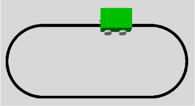

# Line Following on an Oval Track

The robot follows an 8 cm wide black line using three virtual sensor
regions in a downward-facing camera image. The track consists of two
3 m straights connected by semicircles with a radius of 1 m (fig. 1).

*Fig. 1: The robot on an oval test track in Gazebo*

The camera is mounted at the front of the robot and points straight down.
Its optical center is approximately 17.5 cm above the ground. With a
horizontal field of view of 60° and an image resolution of 320 × 240 pixels,
it covers approximately 20.2 cm × 15.2 cm of flat ground, assuming the view
is unobstructed. In this camera setup, one image pixel corresponds to approximately 0.063 cm across the track on the flat ground.

The controller samples three 20 × 20 pixel virtual sensor regions in each grayscale
image. All three use the same image rows (`110:130`), near the vertical
center of the image. The middle region is centered horizontally
(`150:170`), and the two outer regions are placed symmetrically to its
left and right. Each region covers approximately 1.26 cm × 1.26 cm on
the ground.

## Observations

| Trial | Shadows | Line width | Curve radius | Outer sensor spacing (center to center) | Straight speed | Forward speed while steering | Angular speed while steering | Result |
| --- | --- | ---: | ---: | ---: | ---: | ---: | ---: | --- |
| 1 | On | 8 cm | 1.0 m | 10.1 cm | 0.05 m/s | 0.03 m/s | ±0.2 rad/s | Stopped in a curve; both outer sensors reported `DARK` while the line was still visible. |
| 2 | Off | 8 cm | 1.0 m | 10.1 cm | 0.05 m/s | 0.03 m/s | ±0.2 rad/s | Completed a full lap. |
| 3 | Off | 8 cm | 1.0 m | 10.1 cm | 0.10 m/s | 0.06 m/s | ±0.2 rad/s | Stayed on track; steering in the curves looked jerky. |
| 4 | Off | 8 cm | 1.0 m | 10.1 cm | 0.10 m/s | 0.06 m/s | ±0.1 rad/s | Stayed on track; steering looked smoother than in trial 3. |
| 5 | Off | 12 cm | 1.0 m | 10.1 cm | 0.10 m/s | 0.06 m/s | ±0.1 rad/s | Did not move from the starting position. Both outer sensors had a mean brightness of 0.0 and triggered the stop rule. |
| 6 | Off | 12 cm | 1.0 m | 14.5 cm | 0.10 m/s | 0.06 m/s | ±0.1 rad/s | Completed a full lap after the outer sensor regions were moved farther apart. |
| 7 | Off | 8 cm | 0.5 m | 10.1 cm | 0.10 m/s | 0.06 m/s | ±0.1 rad/s | Left the track in the tighter curve. |
| 8 | Off | 8 cm | 0.5 m | 10.1 cm | 0.10 m/s | 0.03 m/s | ±0.1 rad/s | Completed a full lap after reducing the forward speed while steering. |

## Interpretation

**How does line width affect sensor placement?** With the outer sensor
regions 10.1 cm apart, the robot followed the 8 cm line (trial 4). On the 12 cm
line, both outer regions detected the line at the starting position,
triggering the stop rule (trial 5). Increasing their spacing to 14.5 cm allowed
the robot to complete a full lap with the same control logic (trial 6).

**How does line curvature affect the robot's maximum speed?** At a
steering rate of ±0.10 rad/s, the robot completed the 1.0 m curves at
a forward speed of 0.06 m/s while steering (trial 4). At the same settings, it
left the track in a 0.5 m curve (trial 7). Reducing only the forward speed while
steering to 0.03 m/s allowed it to complete a full lap on the tighter
track (trial 8). The tighter curves required a lower speed with this controller.